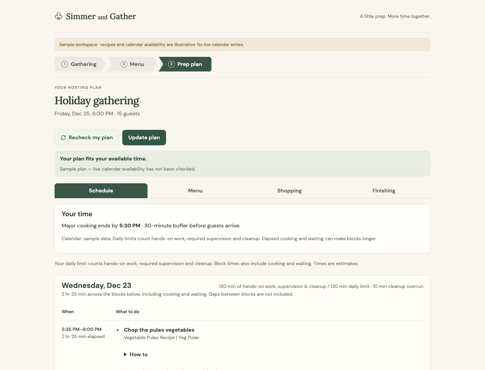
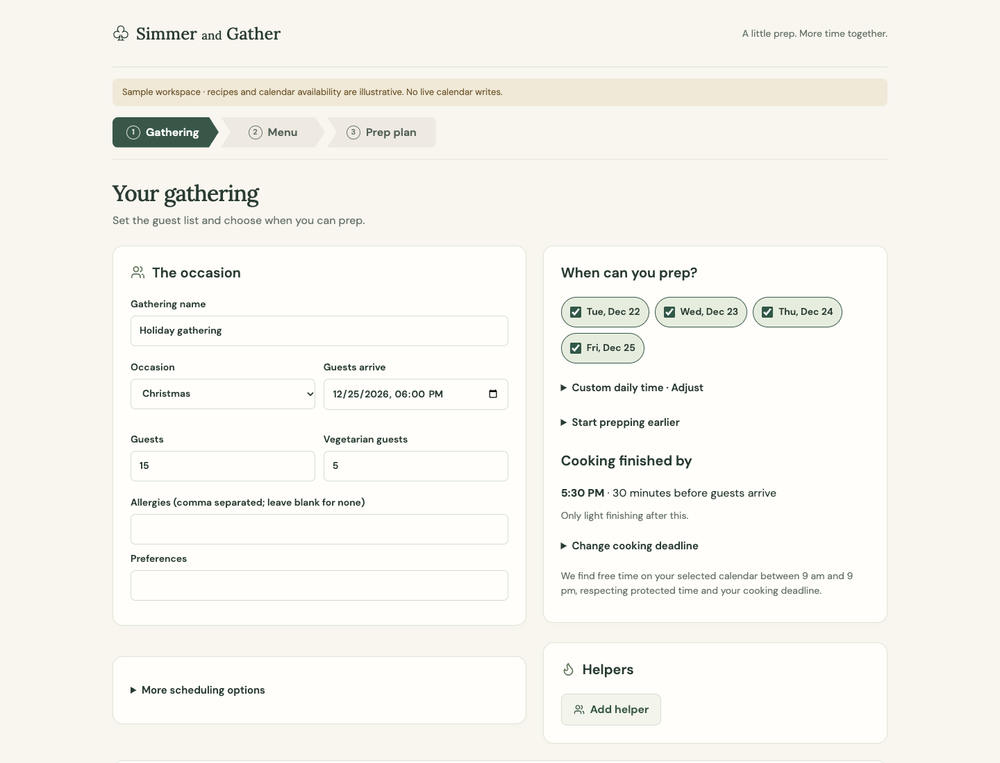
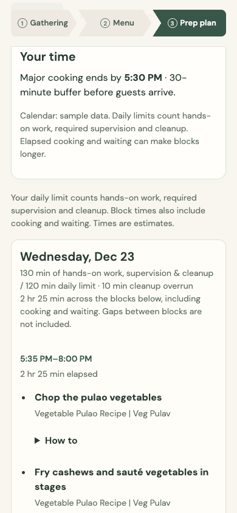
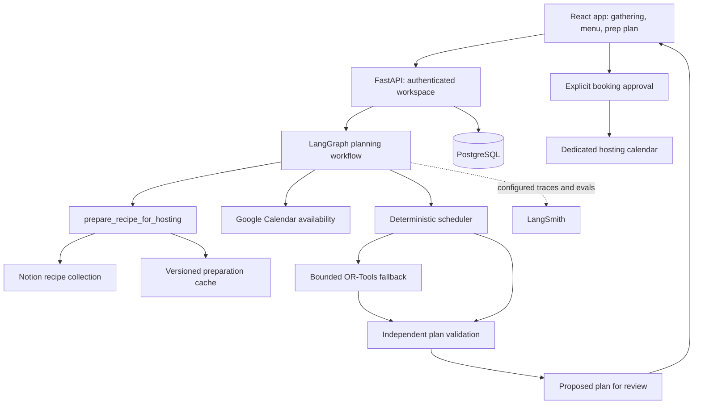

# Simmer and Gather

A hosting assistant that turns a recipe collection, your menu choices and calendar availability into a practical prep plan—so you can enjoy time with your guests.

Built as a personal agentic-AI course demo. The working implementation includes a React app, a LangGraph planning workflow, recipe preparation tools, deterministic scheduling, Notion persistence and approval-gated Google Calendar booking. Hosting deployment and multi-user access are separate from the local demo.

## A look inside

These screenshots show the actual UI with isolated, illustrative test data. They do not display personal calendar events or account credentials.



| Gathering setup | Phone preparation view |
| --- | --- |
|  |  |

## How it works

1. **Set up a gathering.** Choose guests, dietary needs, prep days, daily time limits and a buffer before arrival. The default prep allowance is two hours per day, adjustable for each gathering.
2. **Review the menu.** Use recipes from Notion, swap dishes, mark must-haves, choose bought dishes and record guest contributions. Helper availability can vary by session.
3. **Generate a proposed plan.** Review grouped cooking sessions, task details, ingredient lists and recipe links. Waiting and soaking appear as notes rather than large standalone work blocks.
4. **Adjust and recheck.** Refine the proposal before saving. Calendar availability is checked on demand; there are no background alerts.
5. **Approve calendar booking separately.** Reviewing or generating a plan does not add events. Approved blocks go into a dedicated hosting calendar.

The current personal UI focuses on the Personal calendar. A proposed schedule remains reviewable even when nothing has been booked.

## Agent and tools



One orchestration workflow coordinates bounded tools. Recipe interpretation can use a configured model; time arithmetic, dependency checks and booking safeguards are code. The constraint-solver fallback handles supported solo-host cases rather than treating every difficult schedule as a model problem.

`prepare_recipe_for_hosting` separates hands-on work from passive cooking and waiting, preserves dependencies and make-ahead guidance, and reuses saved results. Recipe/source or preparation-version changes invalidate reusable results. Missing evidence is kept distinct from planning estimates.

## Current scope and limits

- Reviewed recipe collection and repeatable five-menu scheduling audits, with explicit remaining review gaps recorded in the review documents.
- Compact session-first presentation, expandable practical instructions, recipe links and grouped shopping information.
- Notion recipe/plan save paths and Google OAuth integration; real credentials must be configured locally.
- Schedule validation for dependencies, daily effort limits, availability and arrival buffers. A feasible test schedule is not a physical cooking trial.
- Standard family-kitchen assumptions simplify the demo; the app does not establish actual appliance capacity.
- LangSmith instrumentation and evaluation runners are implemented. Live tracing requires configuration; local tests do not prove a hosted LangSmith run.
- Receipt/pantry vision benchmarks exist, but live uploads remain gated pending retention-cleanup verification.
- Cooking progress tracking, voice interaction, weekly meal prep and independent accounts for friends/family are deferred.

## Run locally with sample data

Requirements: Python 3.12–3.14, `uv`, Node.js/npm and Docker with Compose.

```sh
docker compose up -d
uv sync --locked
npm ci --prefix frontend
uv run uvicorn simmer.dev:app --host 127.0.0.1 --port 8000
```

In a second terminal:

```sh
npm --prefix frontend run dev
```

Open the Vite URL printed in the terminal (normally `http://127.0.0.1:5173`). The development entry point seeds sample data and provides a fixture session. **Do not deploy `simmer.dev:app` as a public service.** The local Compose database uses explicitly development-only credentials.

## Connect real services

Follow the [runbook](docs/runbook.md) and [Google OAuth setup](docs/google-oauth-setup.md). `.env.example` documents configuration names; copying it alone does not configure the services. Load environment variables privately before starting the real server.

| Service | Purpose | Configuration |
| --- | --- | --- |
| PostgreSQL | Workspaces, proposals, credentials and cached results | `DATABASE_URL` |
| Google OAuth / Calendar | Sign-in, selected-calendar availability and approved booking | Google client ID/secret, callback, allowed owner/email, session secret and encryption key |
| Notion | Recipe collection and approved plan persistence | Restricted integration token and collection IDs |
| LangSmith | Optional traces and evaluations | API key and tracing settings |
| Fireworks / Nebius | Configured inference or vision benchmarking | Provider keys; paid calls explicitly enabled |
| Tavily | Optional recipe discovery | API key and recipe-search flag |

Build the frontend, then run the authenticated server:

```sh
npm --prefix frontend run build
uv run uvicorn simmer.server:build_app --factory --host 127.0.0.1 --port 8000 --no-access-log
```

Use `http://localhost:8000` consistently with the configured Google callback `http://localhost:8000/api/google/callback`. The real server serves the built frontend. Keep credentials out of shell history, screenshots and commits.

## Tests and evaluations

```sh
uv run pytest -q
npm --prefix frontend test -- --run
npm --prefix frontend run build
uv run python evals/run.py --mode fixtures --split all
```

Tests cover recipe preparation contracts, scheduling, approval boundaries, persistence and UI behavior. Fixture evaluations are repeatable offline checks; live-provider evaluations are separate and can consume credits. The [five-menu review](docs/reviews/2026-10-29-five-menu-rerun.md) records scheduling outcomes and limitations.

README screenshots can be reproduced using `frontend/scripts/readme-screenshots.mjs` with Vite on port 5178 and a Playwright browser installed. The script intercepts API requests with fixture responses; it does not modify saved plans or calendars. Set `CHROME_PATH` to a local Chrome executable if required.

## Cost and privacy

The target is **$5/month**, not a guaranteed hosting quote. Paid models and search are off by default. Cached recipe preparation and deterministic scheduling reduce repeated inference. The implementation reserves a $3 monthly AI envelope with $2 headroom; actual hosting/provider pricing and usage still need review before deployment. See the [budget](docs/budget.md).

Local environment files, databases, credentials, dependency folders and build outputs are excluded from Git. Google credentials are encrypted at rest by the app. Calendar writes require a separate approval. Repository source and review fixtures are not a backup of your live database or Notion workspace.

## Repository guide

- `backend/src/simmer/` — API, domain models, agent workflow, tools and schedulers
- `backend/tests/` — backend regression tests and synthetic fixtures
- `frontend/src/` — responsive UI and component tests
- `evals/` — evaluation cases and runners
- `scripts/` — recipe audits, refinement and development utilities
- `docs/reviews/` — recipe and multi-menu review evidence

## Product and engineering documents

- [PRD](PRD.md)
- [Design](docs/superpowers/specs/2026-10-27-simmer-and-gather-design.md)
- [Implementation plan](docs/superpowers/plans/2026-10-27-hosting-demo.md)
- [Operational runbook](docs/runbook.md)
- [Agentic build coverage](docs/agentic-build-coverage.md)
- [Architecture refinements](docs/architecture-refinement-ledger.md)
- [Recipe collection](docs/recipe-collection.md)
- [Vision benchmark](docs/vision-benchmark.md)
